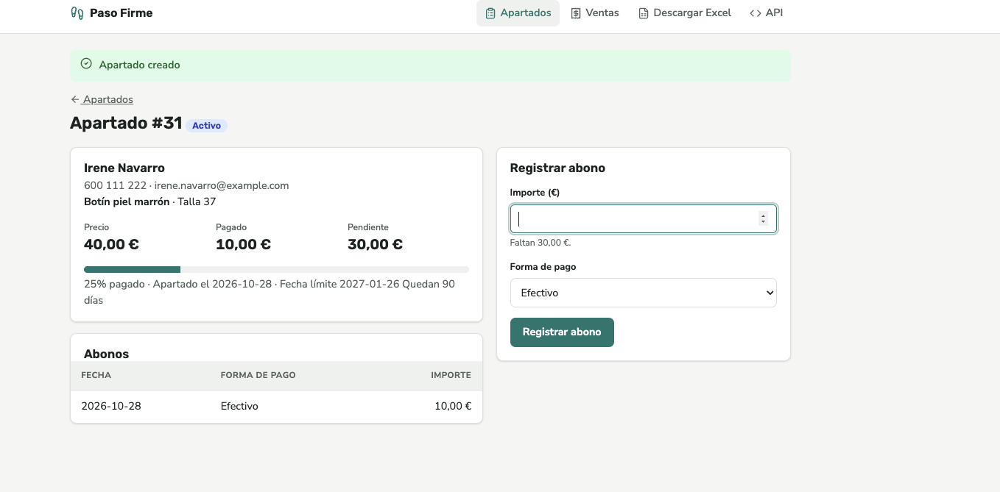
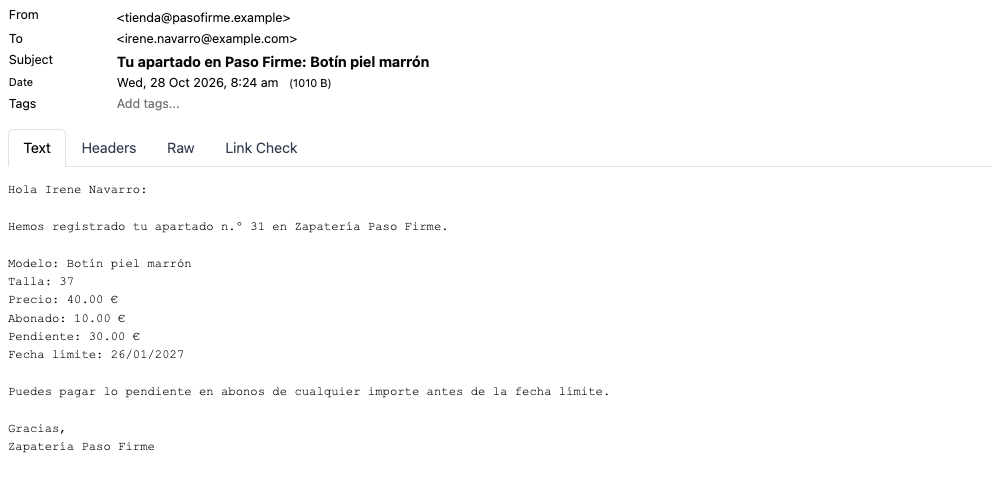
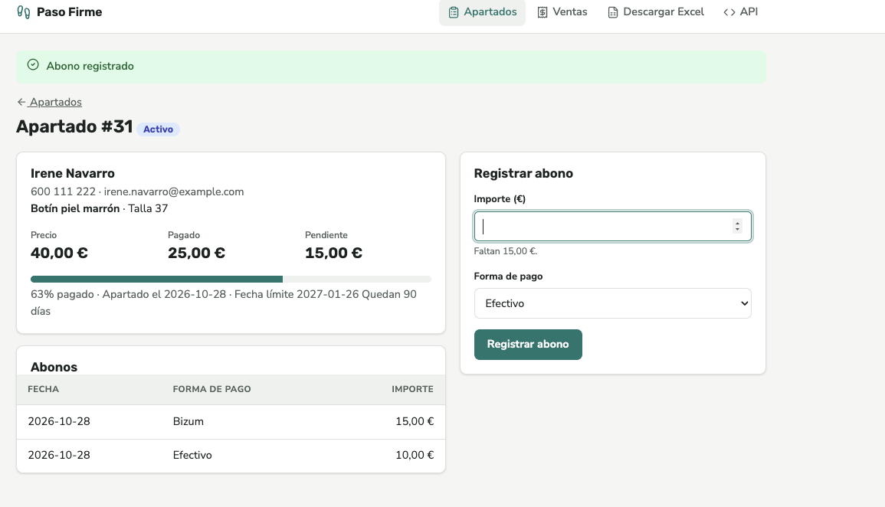
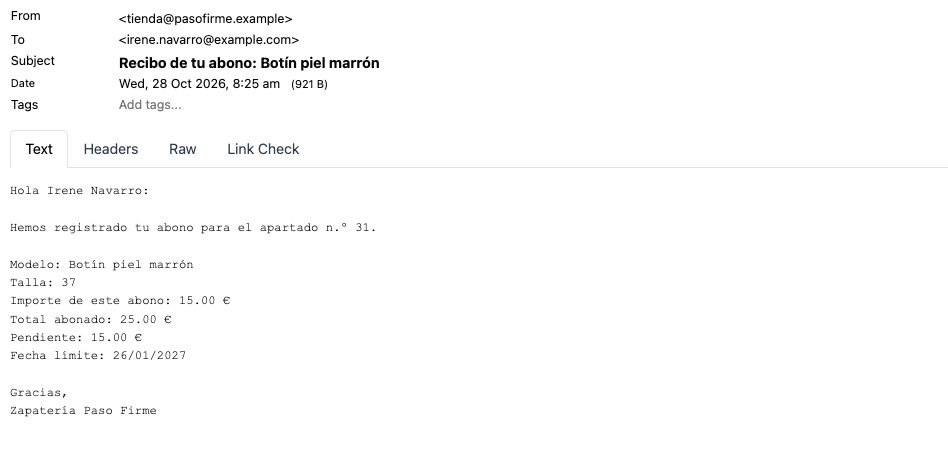
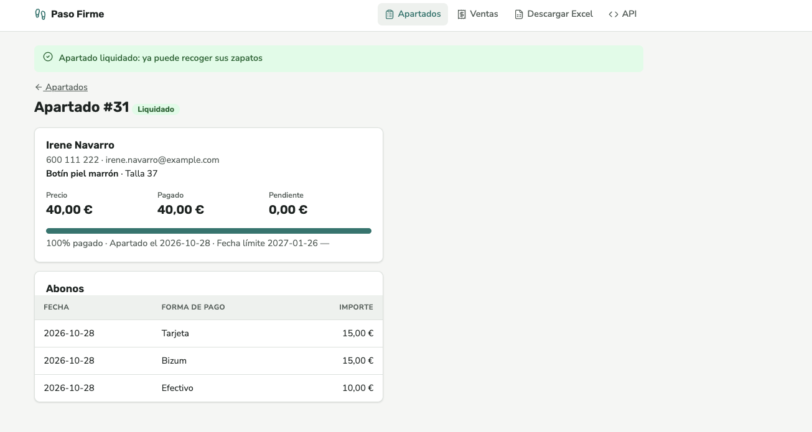
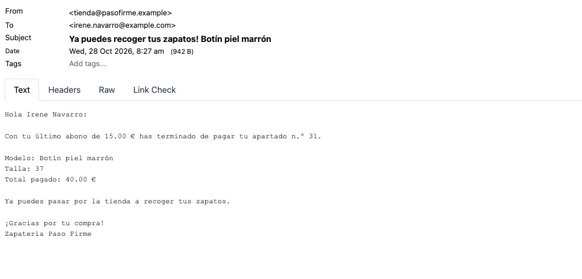
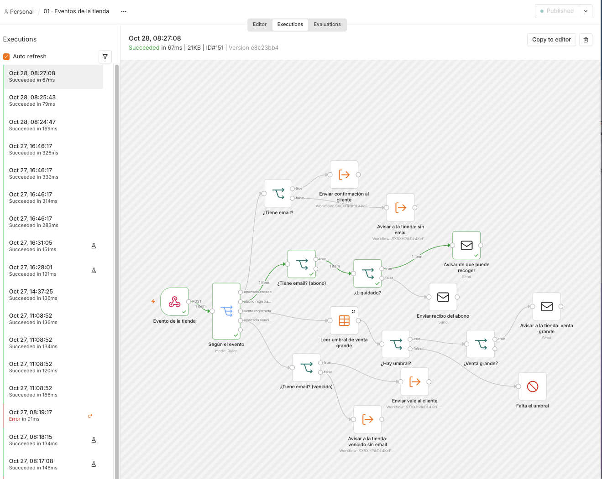

# Evidencias · un apartado completo: alta → abonos → liquidación

Entregable 5 del [README](../../README.md#-entregables) (#144): un apartado de principio a fin en la app real, con los correos que envía n8n en cada paso.

- **Fecha:** 28/10/2026.
- **Entorno:** la app (http://localhost:8000) y `01 · Eventos de la tienda` **publicado**, así que la app envía los eventos a la Production URL (`/webhook/tienda`). Los correos se ven en Mailpit.
- **Quién:** la pareja hizo la prueba y las capturas; el agente la ha documentado a partir de ellas.

> **Datos inventados.** La clienta (Irene Navarro, `irene.navarro@example.com`, 600 111 222) no existe. Antes de la prueba se copió la base de datos de la app en `~/tienda-antes-hu144.db`, y al terminar se restauró, así que el apartado #31 ya no está en la app.

**El apartado:** Botín piel marrón, talla 37, precio 40,00 €.

## 1. Alta con abono inicial

La dependienta crea el apartado en la app con un abono inicial de **10,00 € en efectivo**.

| La app | El correo a la clienta |
|---|---|
|  |  |

- **La app:** «Apartado creado». Apartado **#31**, `activo`. Precio 40,00 €, pagado 10,00 €, pendiente 30,00 €. Apartado el 2026-10-28, fecha límite 2027-01-26 (+ 90 días). Un abono: 2026-10-28, Efectivo, 10,00 €.
- **Evento:** `apartado.creado`.
- **Rama del `01`:** salida `apartado.creado` del Switch `Según el evento` → `¿Tiene email?` (true) → `Enviar confirmación al cliente`, que envía el correo con el sub-workflow `10 · Enviar notificación`.
- **Correo** (Mailpit, 28/10/2026 a las 8:24, de `tienda@pasofirme.example` a `irene.navarro@example.com`): «**Tu apartado en Paso Firme: Botín piel marrón**». Apartado n.º 31, modelo Botín piel marrón, talla 37, precio 40.00 €, abonado 10.00 €, pendiente 30.00 €, fecha límite 26/01/2027.

## 2. Abono parcial

La dependienta registra un abono de **15,00 € por bizum**.

| La app | El correo a la clienta |
|---|---|
|  |  |

- **La app:** «Abono registrado». Sigue `activo`. Pagado 25,00 €, pendiente 15,00 € (63 % pagado). Dos abonos: Bizum 15,00 € y Efectivo 10,00 €.
- **Evento:** `abono.registrado`, con `estado` `activo` (el estado después del abono).
- **Rama del `01`:** salida `abono.registrado` → `¿Tiene email? (abono)` (true) → `¿Liquidado?` (false) → `Enviar recibo del abono`.
- **Correo** (8:25): «**Recibo de tu abono: Botín piel marrón**». Apartado n.º 31, talla 37, importe de este abono 15.00 €, total abonado 25.00 €, pendiente 15.00 €, fecha límite 26/01/2027.

## 3. Abono que liquida el apartado

La dependienta registra el último abono: **15,00 € con tarjeta**.

| La app | El correo a la clienta |
|---|---|
|  |  |

- **La app:** «Apartado liquidado: ya puede recoger sus zapatos». Apartado #31 **`liquidado`**: pagado 40,00 €, pendiente 0,00 € (100 % pagado). Tres abonos: Tarjeta 15,00 €, Bizum 15,00 € y Efectivo 10,00 €. Nadie ha cambiado el estado a mano: lo pone la app cuando `pendiente` llega a 0 €.
- **Evento:** `abono.registrado`, con `estado` `liquidado` y `pendiente` 0.
- **Rama del `01`:** salida `abono.registrado` → `¿Tiene email? (abono)` (true) → `¿Liquidado?` (true) → `Avisar de que puede recoger`.
- **Correo** (8:27): «**Ya puedes recoger tus zapatos! Botín piel marrón**». Último abono 15.00 €, apartado n.º 31, talla 37, total pagado 40.00 € y «Ya puedes pasar por la tienda a recoger tus zapatos».

> El asunto no lleva «¡» al principio. Así está en el Send Email `Avisar de que puede recoger` de `workflows/01-eventos-tienda.json`, de modo que el correo es el esperado. Si se quiere corregir, hay que cambiar el flujo en n8n y volver a exportarlo.

## 4. Las ejecuciones en n8n

- En `01 · Eventos de la tienda` (**Published**), pestaña Executions, aparecen **3 ejecuciones correctas**, una por evento: 28/10 a las **08:24:47**, **08:25:43** y **08:27:08**. Coinciden con la hora de cada correo (8:24, 8:25 y 8:27).
- En la captura está abierta la última (08:27:08, ID #151, «Succeeded in 67ms»). El camino en verde es `Evento de la tienda` → `Según el evento` (salida `abono.registrado`) → `¿Tiene email? (abono)` → `¿Liquidado?` (true) → `Avisar de que puede recoger`.
- Las 3 son ejecuciones de producción, sin el icono de prueba (el matraz) de las ejecuciones manuales de días anteriores. Es decir: las disparó la app al usarla, no una prueba desde el editor.

## 5. Comprobación: cifra de la app = cifra del correo

`abonado`, `pendiente` y `fecha_limite` los calcula la app ([ontología](../ontologia.md#3-apartado)). El `01` solo los lee del evento y los formatea: 2 decimales con punto y la fecha en `dd/MM/yyyy`. No recalcula nada.

| Paso | Dato | La app | El correo | ¿Coincide? |
|---|---|---|---|---|
| 1 · Alta | Precio | 40,00 € | 40.00 € | ✅ |
| 1 · Alta | Abonado (pagado) | 10,00 € | 10.00 € | ✅ |
| 1 · Alta | Pendiente | 30,00 € | 30.00 € | ✅ |
| 1 · Alta | Fecha límite | 2027-01-26 | 26/01/2027 | ✅ |
| 2 · Abono | Importe del abono | 15,00 € (Bizum) | 15.00 € | ✅ |
| 2 · Abono | Total abonado | 25,00 € | 25.00 € | ✅ |
| 2 · Abono | Pendiente | 15,00 € | 15.00 € | ✅ |
| 2 · Abono | Fecha límite | 2027-01-26 | 26/01/2027 | ✅ |
| 3 · Liquidación | Último abono | 15,00 € (Tarjeta) | 15.00 € | ✅ |
| 3 · Liquidación | Total pagado | 40,00 € | 40.00 € | ✅ |
| 3 · Liquidación | Estado | `liquidado` | Mensaje de recogida | ✅ |

En los tres pasos coinciden también el n.º de apartado (31), el modelo (Botín piel marrón) y la talla (37).

## 6. Criterios que demuestra

**HU-01 · Confirmación al apartar**

- ✅ *Al crear un apartado en la app, el cliente recibe un mensaje en menos de un minuto.* La confirmación llega a las 8:24, el mismo minuto que la ejecución (08:24:47). La hora exacta en que se pulsó «crear» en la app no sale en las capturas.
- ✅ *El mensaje incluye modelo, talla, precio, abonado, pendiente y fecha límite, con los importes que da la app.* Ver el paso 1 y la tabla de la sección 5.
- — *Si el cliente no tiene correo…*: esta prueba no lo cubre, porque la clienta tiene email. Está probado en la sección 7 de [specs/01-eventos-tienda.md](../../specs/01-eventos-tienda.md).

**HU-02 · Recibo de cada abono**

- ✅ *Cada abono registrado genera un recibo con el importe pagado y lo que queda pendiente.* Ver el paso 2.
- ✅ *Si el apartado queda liquidado, el mensaje cambia: avisa de que ya puede recoger sus zapatos.* Ver el paso 3: otro asunto y otro texto, sin «Pendiente».

**Nivel esencial** (README): los eventos de la app llegan a n8n, y un único webhook los reparte con el Switch según `evento`. Los mensajes al cliente llevan los importes que da la app.
