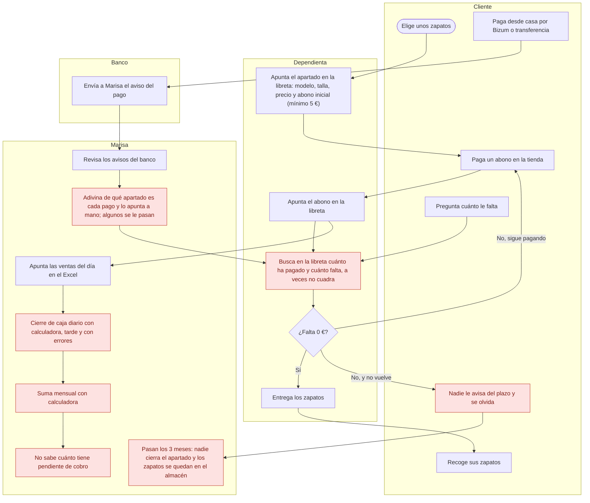
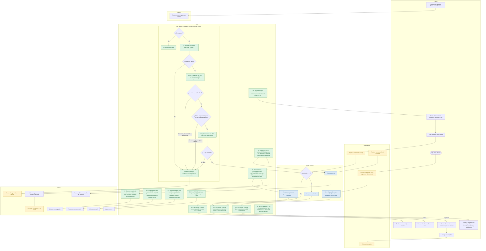
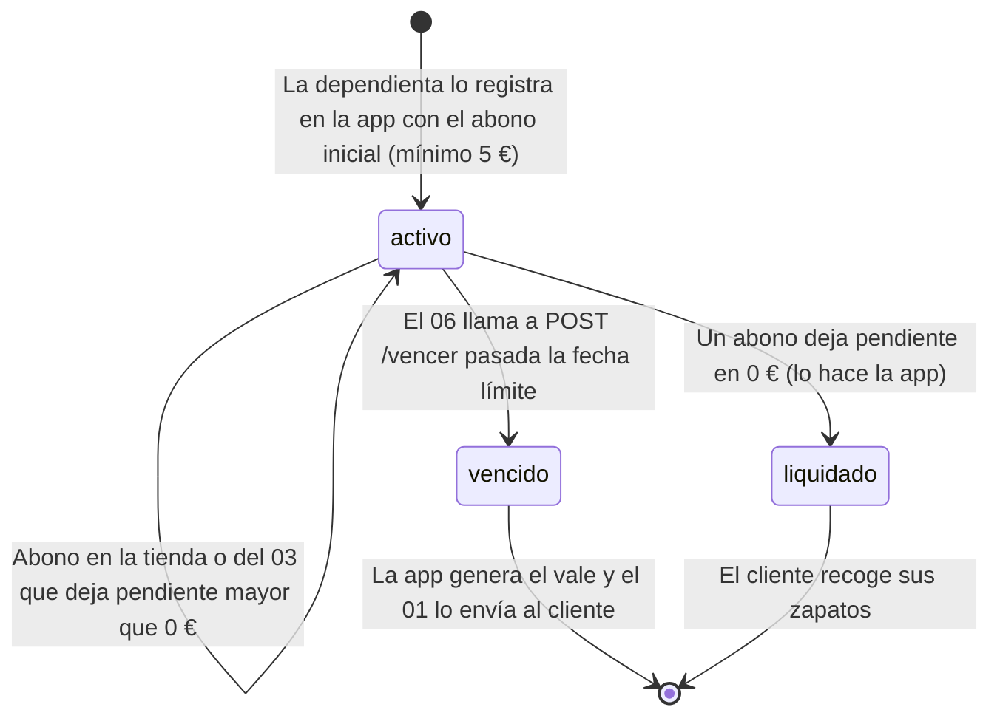

# Mapa del proceso de apartado · hoy y automatizado

Entregable 1 del [README](../README.md#-entregables) (#141): cómo se lleva hoy un apartado en Paso Firme y cómo queda con la app y n8n. Los diagramas son Mermaid, que GitHub dibuja directamente.

Fuentes: el [README](../README.md) (planteamiento, reglas del negocio, automatizaciones e historias de usuario), la [ontología](ontologia.md), la [guía de la app](guia-de-la-app.md), [AGENTS.md](../AGENTS.md) (secciones 2, 5 y 8), las specs de `specs/`, los JSON de `workflows/` y los CSV del Excel antiguo de [`data/`](../data/).

## 1. Hoy (a mano)

Todo se lleva con una libreta, un Excel y la calculadora. En [`data/excel_actual_apartados.csv`](../data/excel_actual_apartados.csv) los apartados y los abonos van mezclados en la misma hoja, con la columna `resta` calculada a mano. En [`data/excel_actual_ventas.csv`](../data/excel_actual_ventas.csv) están las ventas del día, con los abonos apuntados también como ventas y un `TOTAL SEPTIEMBRE (a mano)` al final.

Los pasos en rojo son los problemas que describe el README.

**Problemas** (README, «Planteamiento»):

1. Hay que buscar en la libreta cuánto ha pagado un cliente y cuánto le falta, y a veces las cuentas no cuadran.
2. Nadie avisa a los clientes de que su plazo está a punto de vencer: hay apartados olvidados con zapatos ocupando el almacén.
3. El cierre de caja diario y la suma mensual se hacen con calculadora, tarde y con errores.
4. Marisa no sabe en ningún momento cuánto dinero tiene pendiente de cobro.
5. Con los pagos por Bizum o transferencia, Marisa tiene que revisar los avisos del banco, adivinar de qué apartado es cada uno y apuntarlo a mano; algunos se le pasan.

## 2. Automatizado (app y n8n)

La dependienta registra en la app los apartados, los abonos en la tienda y las ventas. La app calcula `abonado`, `pendiente`, `fecha_limite` y el estado, y avisa a n8n por el webhook (`POST /webhook/tienda`, un solo Switch en el `01`). Los flujos programados consultan la API.

Los pasos en verde los hace n8n, y cada uno lleva el nombre del flujo y su disparador. Los azules son de la app. Los amarillos siguen siendo trabajo de personas.

Cómo se lee:

- **Lo que sigue siendo humano:**
  - el alta del apartado, los abonos en la tienda y las ventas directas, que la dependienta registra en la app;
  - entregar los zapatos;
  - revisar los pagos dudosos del `03`;
  - devolver a la venta los zapatos de los apartados vencidos.
- **El `03` no decide con la IA.** La IA solo extrae ordenante, importe y concepto. Los rombos son reglas del flujo con los datos de la API. Si el flujo registra el abono, la app envía `abono.registrado` y el recibo lo manda el `01`, igual que para un abono en la tienda. Las transferencias también se registran con `forma_pago` `bizum`, porque la app no acepta `transferencia` (AGENTS.md, sección 8). El disparador final es el correo del banco por IMAP; para las pruebas, el flujo tiene un formulario con el asunto y el cuerpo.
- **Clientes sin email** (no aparecen en el diagrama):
  - en la confirmación (HU-01) y en el vale (HU-07), el `01` avisa a la tienda con el teléfono;
  - en el recibo de un abono (HU-02), no se envía nada (AGENTS.md, sección 8).
- **El vale lo envía el `01`, no el `06`.** El `06` vence el apartado con `POST /api/apartados/{id}/vencer` y la app envía el webhook `apartado.vencido`. Así el cliente recibe su vale aunque el apartado se venza por otra vía.
- **El orden de la noche:** el `11` importa el datáfono a las 22:00 (de lunes a sábado), y a las 00:05 el `05` cierra el día anterior con lo importado. Las ventas del datáfono que superan el umbral también pasan por el aviso de venta grande del `01`.
- **El `08`** está asignado como Error workflow en el `01`, el `03`, el `05`, el `06`, el `07`, el `09` y el `11`. Los sub-workflows `10` no lo tienen: sus errores los avisa el `08` del flujo que los llama.
- **Fuera del ciclo:** `09 · Migración del Excel` se usa una vez, con un formulario, para pasar a la app los CSV de `data/`. Los casos dudosos van en un informe a la tienda.
- Todos los correos a Marisa llegan a `tienda@pasofirme.example` (en las pruebas, por Mailpit).

## 3. Ciclo de vida del apartado

Los estados son los de la [ontología](ontologia.md#estados): `activo`, `liquidado` y `vencido`.

Un apartado con la `fecha_limite` pasada sigue `activo` hasta que el `06` lo vence; la app no lo hace sola. El `06` solo vence los que tienen la `fecha_limite` anterior a hoy, así que el día de la fecha límite todavía se puede abonar.

## 4. Antes → después

| Problema de hoy (README) | Cómo queda | Flujo |
|---|---|---|
| Buscar en la libreta cuánto ha pagado y cuánto falta; las cuentas no cuadran | La app calcula `abonado` y `pendiente`. El cliente los recibe en cada confirmación y recibo, con los importes de la app, sin recalcular | [`01 · Eventos de la tienda`](../specs/01-eventos-tienda.md) |
| Nadie avisa del plazo; zapatos olvidados en el almacén | Recordatorio a 7 días y a 1 día. Pasado el plazo, el apartado se vence por API, el cliente recibe su vale y Marisa la lista de zapatos que vuelven a la venta | [`06 · Recordatorios y vencimientos`](../specs/06-recordatorios-vencimientos.md) y la rama `apartado.vencido` del [`01`](../specs/01-eventos-tienda.md) |
| Cierre de caja diario con calculadora | Cada noche, un resumen de ventas directas, abonos y total por forma de pago, guardado también en Google Sheets | [`05 · Cierre diario`](../specs/05-cierre-diario.md) |
| Suma mensual con calculadora | El día 1, un informe con la recaudación del mes anterior (ventas directas y abonos por separado) y los apartados nuevos, liquidados y vencidos | [`07 · Informe mensual`](../specs/07-informe-mensual.md) |
| No sabe cuánto tiene pendiente de cobro | El informe mensual trae el total pendiente de cobro (suma del `pendiente` de los apartados `activo` que da la app). Con su formulario se puede pedir cualquier día, y da el pendiente del momento | [`07 · Informe mensual`](../specs/07-informe-mensual.md) |
| Revisar los avisos del banco, adivinar el apartado y apuntarlo; algunos se pasan | Cada correo del banco se lee solo: se registra el abono si el apartado está claro y se puede abonar; si no, no se registra nada y se pregunta a Marisa con el motivo | [`03 · Abonos a distancia`](../specs/03-abonos-distancia.md) |

Además, sin un problema propio en el README:

- [`01 · Eventos de la tienda`](../specs/01-eventos-tienda.md): el aviso de venta grande (HU-09).
- [`11 · Datáfono`](../specs/11-datafono.md): los cobros con tarjeta entran solos (HU-13).
- [`08 · Error Workflow`](../specs/08-error-workflow.md): si una automatización falla, Marisa se entera (HU-05).
- [`10 · Buscar apartado` y `10 · Enviar notificación`](../specs/10-sub-workflows.md): sub-workflows comunes a los flujos.
