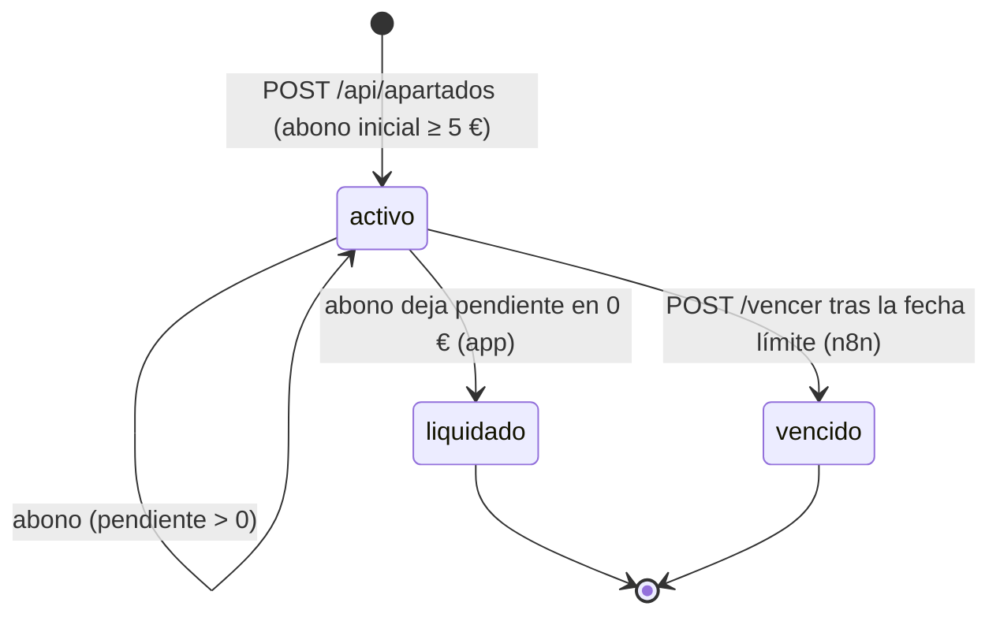
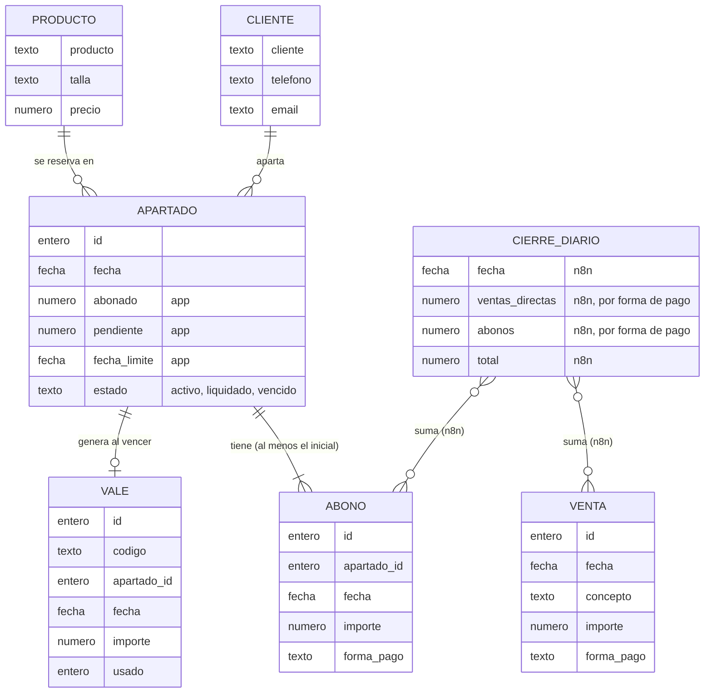

# Ontología del dominio · Zapatería Paso Firme

Este documento describe las entidades del negocio de Paso Firme, sus atributos, cómo se relacionan y qué reglas les afectan. Está construido **solo** con la información del [README](../README.md) y de la [Guía de la app](guia-de-la-app.md).

## Cómo leer este documento

- **Atributos:** son los campos que devuelve o acepta la API de la app (`/api/...`) o el webhook. No se añaden campos que la app no tenga.
- **Quién calcula cada dato:**
  - 🏪 **App**: lo calcula o lo genera la app de la tienda. n8n **solo lo lee**, nunca lo recalcula.
  - ⚙️ **n8n**: la app no lo calcula; lo tiene que obtener un flujo de n8n a partir de la API.
- **Entidades que la app no guarda por separado:** `Cliente` y `Producto` no tienen tabla ni endpoint propios; sus datos viven dentro de cada `Apartado`. `CierreDiario` no existe en la app: lo construye n8n y lo guarda fuera (por ejemplo, en Google Sheets).

| Entidad | ¿Existe en la API? | Dónde se consulta |
|---|---|---|
| Cliente | No (campos dentro de `Apartado`) | `GET /api/apartados?q=...` |
| Producto | No (campos dentro de `Apartado`) | `GET /api/apartados?q=...` |
| Apartado | Sí | `GET /api/apartados`, `GET /api/apartados/{id}`, `GET /api/apartados/resumen` |
| Abono | Sí | `GET /api/abonos`, detalle del apartado |
| Venta | Sí | `GET /api/ventas` |
| Vale | Sí | `GET /api/vales`, detalle del apartado |
| CierreDiario | No (lo crea n8n) | Herramienta externa (Google Sheets o similar) |

---

## 1. Cliente

Persona que aparta unos zapatos. La app no tiene un registro de clientes: cada apartado lleva los datos de su cliente.

### Atributos

| Nombre | Tipo | Descripción | Calcula |
|---|---|---|---|
| `cliente` | texto | Nombre del cliente (obligatorio al crear el apartado) | — |
| `telefono` | texto | Teléfono (opcional) | — |
| `email` | texto | Correo (opcional). Es por donde n8n le envía los mensajes | — |

> ⚠️ **Consentimiento:** la app no tiene ningún campo de consentimiento (ni en el apartado ni en otra tabla). Para cumplir la HU-14, n8n tendrá que guardar qué clientes han dado su consentimiento **fuera de la app** (por ejemplo, en Google Sheets).

### Relaciones

- Un cliente puede tener **uno o varios apartados** (cada uno con sus propios datos de cliente).
- Un cliente puede tener **vales** de compra, a través de sus apartados vencidos.

### Reglas del negocio

- Como no hay identificador de cliente, se busca con `GET /api/apartados?q=...` (por nombre, teléfono, producto o nº de apartado). Un mismo cliente puede aparecer escrito de varias maneras (por ejemplo, en el Excel antiguo o en los avisos del banco).
- Si el cliente no tiene correo, el flujo no debe fallar: avisa a la tienda de que no se pudo enviar el mensaje (HU-01).
- Solo se envían mensajes a clientes que han dado su consentimiento y solo los datos imprescindibles salen hacia modelos de IA (HU-14, RGPD).
- Por Telegram, un cliente solo puede ver sus propios apartados (HU-11).

---

## 2. Producto

Par de zapatos que se aparta. Igual que el cliente, no tiene endpoint propio: sus datos van dentro del apartado.

### Atributos

| Nombre | Tipo | Descripción | Calcula |
|---|---|---|---|
| `producto` | texto | Modelo de los zapatos (obligatorio al crear el apartado) | — |
| `talla` | texto | Talla (opcional; en la API va como texto, por ejemplo `"38"`) | — |
| `precio` | número (€) | Precio total del par (obligatorio) | — |

### Relaciones

- Cada **apartado** corresponde a **un solo producto** (modelo + talla).
- Las **ventas directas** no enlazan con un producto: solo llevan un `concepto` de texto libre.

### Reglas del negocio

- **Un apartado = un par**: un apartado nunca agrupa varios productos.
- Mientras el apartado está `activo`, los zapatos están reservados en el almacén.
- Si el apartado **vence**, los zapatos vuelven a la venta y n8n avisa a la tienda con la lista (HU-07).

---

## 3. Apartado

Entidad central del negocio: reserva de un par de zapatos que el cliente va pagando a plazos.

### Atributos

| Nombre | Tipo | Descripción | Calcula |
|---|---|---|---|
| `id` | entero | Nº de apartado | 🏪 App |
| `fecha` | fecha (`AAAA-MM-DD`) | Fecha del apartado. Si no se envía, la app usa hoy (solo se envía para migrar datos antiguos) | 🏪 App (o dato de migración) |
| `cliente` | texto | Ver [Cliente](#1-cliente) | — |
| `telefono` | texto | Ver [Cliente](#1-cliente) | — |
| `email` | texto | Ver [Cliente](#1-cliente) | — |
| `producto` | texto | Ver [Producto](#2-producto) | — |
| `talla` | texto | Ver [Producto](#2-producto) | — |
| `precio` | número (€) | Ver [Producto](#2-producto) | — |
| `abonado` | número (€) | Suma de todos los abonos del apartado | 🏪 App |
| `pendiente` | número (€) | Lo que falta por pagar (`precio` − `abonado`) | 🏪 App |
| `fecha_limite` | fecha (`AAAA-MM-DD`) | `fecha` + 90 días | 🏪 App |
| `estado` | texto (`activo`, `liquidado`, `vencido`) | Estado actual del apartado | 🏪 App (`vencido` solo cuando n8n llama a `/vencer`) |
| `abonos` | lista de [Abono](#4-abono) | Solo en el detalle (`GET /api/apartados/{id}`) | 🏪 App |
| `vale` | [Vale](#6-vale) o `null` | Solo en el detalle; tiene valor si el apartado está vencido | 🏪 App |

Campos que solo se **envían** al crear (`POST /api/apartados`), no se devuelven como tales:

| Nombre | Tipo | Descripción |
|---|---|---|
| `abono_inicial` | número (€) | Importe del primer abono (obligatorio). Se guarda como un [Abono](#4-abono) |
| `forma_pago` | texto (`efectivo`, `tarjeta`, `bizum`) | Forma de pago del abono inicial (opcional). Si no se envía, la app usa `"efectivo"` |

### Relaciones

- Pertenece a **un cliente** y reserva **un producto**.
- Tiene **uno o más abonos** (al menos el abono inicial).
- Tiene **cero o un vale**: solo si ha vencido.

### Reglas del negocio

| Regla | Detalle | Quién la aplica |
|---|---|---|
| Abono inicial | Mínimo **5 €** y no más que el precio | 🏪 App (error `422`) |
| Plazo | `fecha_limite` = `fecha` + 90 días (3 meses) | 🏪 App |
| Abonos | De cualquier importe, nunca más de lo que falta | 🏪 App (error `422`) |
| Forma de pago | Solo admite `efectivo`, `tarjeta` o `bizum`; cualquier otro valor devuelve `422` | 🏪 App (error `422`) |
| Abonar | Solo si está `activo` **y** no ha pasado su `fecha_limite` | 🏪 App (error `422`) |
| Liquidación | Cuando `pendiente` llega a 0 €, pasa a `liquidado` y el cliente puede recoger sus zapatos | 🏪 App (automático) |
| Vencimiento | Si pasan los 90 días sin liquidar, hay que vencerlo; lo abonado se convierte en un vale (no se devuelve en efectivo) | ⚙️ n8n detecta y llama a `POST /api/apartados/{id}/vencer`; 🏪 App cambia el estado y genera el vale |
| Recordatorios | Avisar al cliente cuando faltan 7 días y 1 día para la `fecha_limite`, una sola vez cada aviso | ⚙️ n8n (flujo 6) |
| Importes en mensajes | Los mensajes usan `abonado` y `pendiente` de la app, nunca recalculados | ⚙️ n8n (solo lee) |

### Estados

| Estado | Significado | Cómo se llega | ¿Admite abonos? |
|---|---|---|---|
| `activo` | Se está pagando. Estado inicial al crear el apartado | Al crear el apartado | Sí, si no ha pasado la `fecha_limite` |
| `liquidado` | Pagado entero; el cliente puede recoger los zapatos | La **app** lo pone sola cuando un abono deja `pendiente` en 0 € | No (estado final) |
| `vencido` | Se pasó de plazo; se generó un vale con lo abonado | **n8n** llama a `POST /api/apartados/{id}/vencer` (solo si ya pasó la `fecha_limite`) | No (estado final) |

> ⚠️ Un apartado con la `fecha_limite` pasada **sigue `activo`** hasta que n8n lo vence. La app no lo hace sola.

---

## 4. Abono

Pago parcial de un apartado. El abono inicial también es un abono.

### Atributos

| Nombre | Tipo | Descripción | Calcula |
|---|---|---|---|
| `id` | entero | Identificador del abono | 🏪 App |
| `apartado_id` | entero | Apartado al que pertenece | — |
| `fecha` | fecha (`AAAA-MM-DD`) | Fecha del abono. Si no se envía, la app usa hoy (solo se envía para migrar) | 🏪 App (o dato de migración) |
| `importe` | número (€) | Cantidad pagada (obligatorio) | — |
| `forma_pago` | texto (`efectivo`, `tarjeta`, `bizum`) | Forma de pago (opcional). Si no se envía, la app usa `"efectivo"` | 🏪 App (valor por defecto) |

### Relaciones

- Pertenece a **un apartado**.
- Cuenta para el **cierre diario** y la **recaudación mensual**.

### Reglas del negocio

- Solo se puede abonar a un apartado `activo` que no haya pasado su `fecha_limite` (si no, `422`).
- El importe nunca puede superar el `pendiente` del apartado (si no, `422`).
- `forma_pago` solo admite `efectivo`, `tarjeta` o `bizum`; cualquier otro valor devuelve `422`.
- Tras cada abono la app recalcula `abonado` y `pendiente`, y si `pendiente` llega a 0 pone el apartado en `liquidado`.
- El webhook `abono.registrado` envía el apartado ya actualizado más el `importe` recién abonado; `datos.estado` es el estado **después** del abono.
- **Abonos a distancia (flujo 3):** la IA solo extrae ordenante, importe y concepto del aviso del banco; el flujo decide con la API qué apartado es. Si no está claro, si paga de más o si el apartado está fuera de plazo, **no se registra nada** y se avisa a Marisa.
- **Migración:** los abonos del Excel se crean con su `fecha` original; un abono inicial por debajo de 5 € no se carga y va al informe de casos dudosos.

> ⚠️ **Flujo 3 (abonos a distancia):** hay que enviar siempre `forma_pago` `"bizum"` (también para las transferencias, porque la app no acepta `"transferencia"`; ver [AGENTS.md, sección 8](../AGENTS.md#8-decisiones-tomadas)). Si no se envía, la app guarda el pago como `efectivo` y el cierre diario sale mal.

---

## 5. Venta

Venta directa en la tienda, sin apartado.

### Atributos

| Nombre | Tipo | Descripción | Calcula |
|---|---|---|---|
| `id` | entero | Identificador de la venta | 🏪 App |
| `fecha` | fecha (`AAAA-MM-DD`) | Fecha de la venta. Si no se envía, la app usa hoy | 🏪 App (o dato de migración) |
| `concepto` | texto | Qué se ha vendido (obligatorio) | — |
| `importe` | número (€) | Importe de la venta (obligatorio) | — |
| `forma_pago` | texto (`efectivo`, `tarjeta`, `bizum`) | Forma de pago (opcional). Si no se envía, la app usa `"efectivo"` | 🏪 App (valor por defecto) |

### Relaciones

- No se relaciona con ninguna otra entidad de la app.
- Cuenta para el **cierre diario** y la **recaudación mensual** (como "ventas directas").

### Reglas del negocio

- Cada venta dispara el webhook `venta.registrada`.
- `forma_pago` solo admite `efectivo`, `tarjeta` o `bizum`; cualquier otro valor devuelve `422`.
- **Venta grande (flujo 4):** si el `importe` supera un umbral que decide Marisa, n8n le avisa. El umbral se guarda en la Data table `Configuración` de n8n, no en el flujo (ver [AGENTS.md, sección 8](../AGENTS.md#8-decisiones-tomadas)). ⚙️ n8n
- **Datáfono (nivel avanzado):** las ventas con tarjeta importadas del CSV no deben duplicar las ya registradas. ⚙️ n8n

---

## 6. Vale

Vale de compra que se genera cuando un apartado vence: lo abonado no se devuelve en efectivo.

### Atributos

| Nombre | Tipo | Descripción | Calcula |
|---|---|---|---|
| `id` | entero | Identificador del vale | 🏪 App |
| `codigo` | texto | Código del vale (por ejemplo, `VALE-00016`) | 🏪 App |
| `apartado_id` | entero | Apartado vencido del que procede | 🏪 App |
| `fecha` | fecha (`AAAA-MM-DD`) | Fecha en que se generó | 🏪 App |
| `importe` | número (€) | Lo que el cliente había abonado | 🏪 App |
| `usado` | entero | Indica si el vale se ha usado (en el ejemplo, `0`). La guía no documenta cómo se marca como usado | 🏪 App |

### Relaciones

- Procede de **un apartado** vencido (relación uno a uno).
- Pertenece, a través de ese apartado, a **un cliente**.

### Reglas del negocio

- Solo lo genera la app al llamar a `POST /api/apartados/{id}/vencer`.
- Su importe es lo abonado en el apartado; nunca se devuelve en efectivo.
- El webhook `apartado.vencido` lleva `{ "apartado": {...}, "vale": {...} }`; n8n avisa al cliente con el `codigo` y el `importe` del vale (HU-07).

---

## 7. CierreDiario

Resumen de lo cobrado en un día. **No existe en la app**: lo calcula n8n cada noche (flujo 5) y lo guarda en una herramienta externa (Google Sheets o similar), porque la app no guarda el histórico de cierres.

### Atributos

La API no define esta entidad. Sus datos son los que piden el README (HU-04) y las cifras de Marisa, y todos los calcula ⚙️ **n8n** a partir de `GET /api/ventas` y `GET /api/abonos` con `desde` = `hasta` = el día:

| Nombre | Tipo | Descripción | Calcula |
|---|---|---|---|
| Fecha | fecha (`AAAA-MM-DD`) | Día del cierre | ⚙️ n8n |
| Ventas directas | número (€) | Suma de las ventas del día, separada por forma de pago (efectivo, tarjeta, Bizum) | ⚙️ n8n |
| Abonos | número (€) | Suma de los abonos del día (incluidos los iniciales), separada por forma de pago | ⚙️ n8n |
| Total | número (€) | Ventas del día = ventas directas + abonos | ⚙️ n8n |

> Los nombres exactos de las columnas los decide cada pareja al guardar el cierre; aquí solo se recoge qué datos debe llevar.

### Relaciones

- Agrega las **ventas** y los **abonos** de un día.
- Los cierres de un mes sirven de base para la **recaudación mensual** (flujo 7).

### Reglas del negocio

- Se ejecuta cada noche (Schedule Trigger) y consulta la API; **no depende de los webhooks**, porque un aviso perdido no se reintenta.
- Si ese día no hubo movimientos, el resumen lo dice en vez de fallar.
- Los importes deben coincidir con los de la app.
- Se envía el resumen a Marisa.

---

## Quién calcula qué: resumen

| Dato | Calcula | Cómo se obtiene |
|---|---|---|
| `abonado`, `pendiente` de un apartado | 🏪 App | Campos del apartado |
| `fecha_limite` | 🏪 App | `fecha` + 90 días |
| Estado `liquidado` | 🏪 App | Automático al dejar `pendiente` en 0 |
| Estado `vencido` y el vale (`codigo`, `importe`) | 🏪 App, **cuando n8n lo pide** | `POST /api/apartados/{id}/vencer` |
| Recuento de apartados por estado | 🏪 App | `GET /api/apartados/resumen` |
| Nº total de resultados de una lista | 🏪 App | Cabecera `X-Total-Count` |
| Qué apartados están fuera de plazo | ⚙️ n8n | `estado=activo` y `fecha_limite` anterior a hoy |
| Qué apartados vencen en 7 días y en 1 día | ⚙️ n8n | Comparar `fecha_limite` con hoy |
| Ventas del día por forma de pago (cierre diario) | ⚙️ n8n | Sumar `GET /api/ventas` + `GET /api/abonos` del día |
| Recaudación mensual (ventas directas y abonos por separado) | ⚙️ n8n | Sumar ventas y abonos del mes |
| Total pendiente de cobro | ⚙️ n8n | Sumar `pendiente` de los apartados `activo` |
| Apartados nuevos, liquidados y vencidos del mes | ⚙️ n8n | A partir de los apartados y vales de la API |
| Si una venta es "grande" | ⚙️ n8n | Comparar `importe` con el umbral guardado en la Data table `Configuración` de n8n (ver [AGENTS.md, sección 8](../AGENTS.md#8-decisiones-tomadas)) |
| Datos de un aviso del banco (ordenante, importe, concepto) | ⚙️ n8n (IA) | Extracción con IA; la decisión la toma el flujo con la API |

---

## Diagrama de relaciones

`Cliente` y `Producto` se dibujan como entidades conceptuales: en la app sus datos van dentro de `Apartado`. `CierreDiario` vive fuera de la app.

